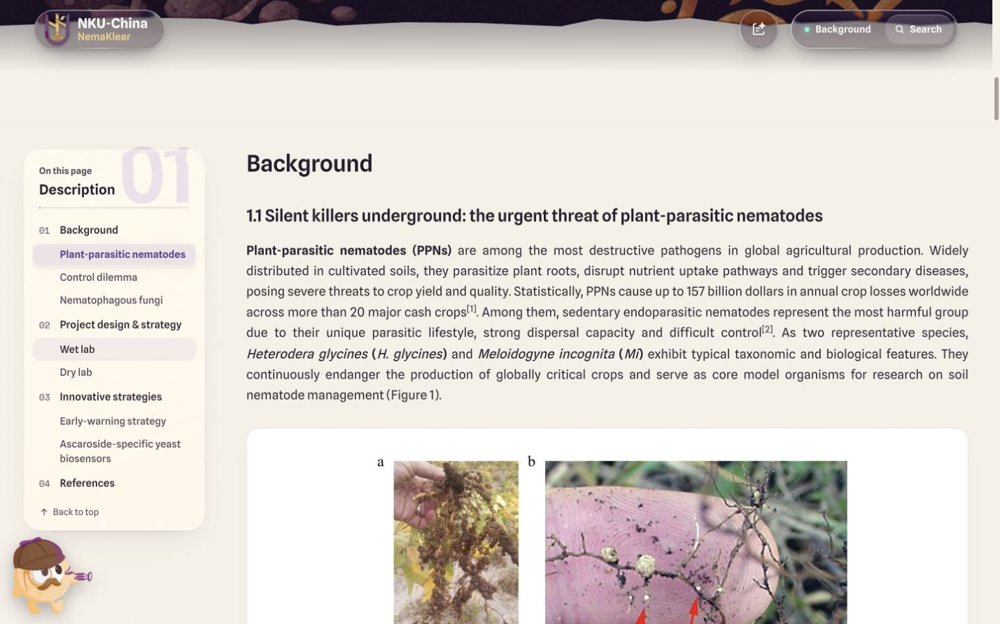
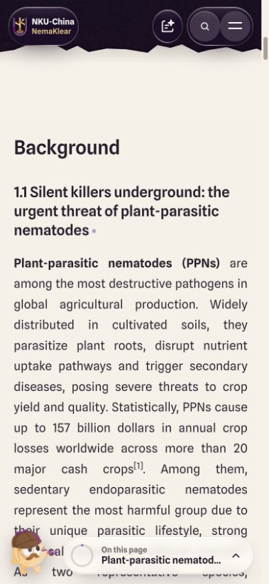
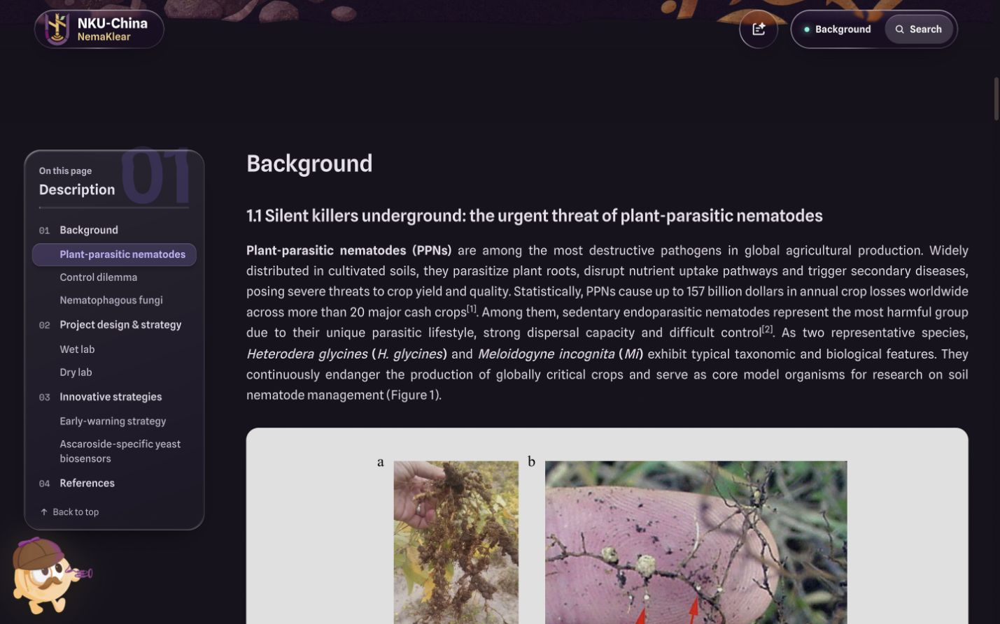

# 全站内容页硬性规则修改交付

日期：2026-10-20

## 交付位置与状态

- 任务：`bug-rules`，分支：`codex/bug-rules`。
- 实际源码：`/Users/cjrmacbook/Documents/ChatGPT/NKU26-wiki-进度总揽/workspace/tasks/bug-rules`。
- 实施基线：`e205f4a5c5ade14f1c38e6836a2b41521b20bf5e`。
- 本地预览：<http://127.0.0.1:4387/description/>，端口 `4387`，服务目录为本任务的 `public/`。
- 准确结果 SHA 及预览归属登记在根工作区 `workspace/registry/tasks/bug-rules.json` 的 `result_commit` 与 `preview`。
- 已完成本地修改、提交和技术验收；未合并至 integration，未推送或发布。

## 完成内容

| 规则 | 实施与证据 |
| --- | --- |
| 所有标题句首大写，保留专名与缩写 | 26 个内容源的页面、章节、目录、组件标题已修改；独立复审覆盖 627 个标题及目录字段，并修复 PDF 缩写误改 |
| 一级标题删除编号，二级标题连续编号 | 内容源已更新，生成 HTML 按所在章节核对 h2/h3；保留稳定锚点、目录序号与淡色装饰序号 |
| 字体、字号、字重、行高与间距 | 公共 `content-rules.css` 统一实现，覆盖冲突的局部与行内样式；普通正文和特殊组件分开处理 |
| 正文与组件外框同宽、段落两端对齐 | 全文检查实际边界、字号、字重、行高及对齐；手机保留左右各 20px |
| 图片完整等比显示、白底圆角 | 公共图片框统一，保留图片原始地址和比例；深色模式白底照片面板的标签使用深色文字 |
| 科学名称与引用排版 | 物种名及约定简称使用斜体；人物纯文本任务通过安全渲染器显示物种斜体，继续转义任意 HTML |
| 所有专业名词逐页统一 | 完成 203 条逐页首次全称与缩写定义，跨组复审 66 个缩写；精确材料标识、公式、数据表原值和文献原题保留 |
| 无确定通用缩写的术语 | 按用户决定保留全称，168 个去重词项交负责人确认，见下方清单 |
| 历史原稿仅保留在历史页 | `/source-archive/` 保留文档与下载；其他页正文、公共页脚、菜单、搜索及改动弹窗不展示历史文档文字或入口；README 原始发布记录未改写 |
| 删除正文重复翻页链接 | 已移除正文独立的返回总览、上一页／下一页重复链接，保留统一底部翻页及科学交叉引用、资料下载 |

额外修正 Results 的章节包装结构：第三章从第二章内部移出，三个一级章节恢复为兄弟节点，使一级章节间距和目录对应关系成立。可见文字、图表、视频、链接及锚点保持。

## 负责人确认清单

- [专业名词负责人确认清单](专业名词负责人确认清单.md)：168 个保留全称的词项及出现页面。
- [合并术语明细](专业名词负责人确认清单.json)：包括 203 条已定义术语的逐页首次位置。
- 分组记录：[实验／项目／团队术语表](术语表-wet.md)、[模型／HP 术语表](术语表-model-hp.md)。

## 验证结果

- 最终 `npm run build` 成功，生成 30 个 HTML 页面；其中覆盖 26 个内容源及兼容入口。
- 26 个内容源的生成页结构、编号、历史入口、重复导航、唯一 ID、受保护数据字段和历史下载目标审计通过。
- 额外检查首页、组件库及两个兼容入口，均无历史文档文字或入口残留。
- 浏览器在 1440×900 与 390×844 下检查 26 个内容页及两个兼容入口，共 56 组，全部通过正文及标题指标、正文左右边界、对齐和整页水平溢出检查。
- 深色模式正文保持 18px 与两端对齐；照片面板内标签为深色文字、面板为白色。
- 82 项自动化回归通过：图注 7、媒体 2、主题 18、部署相关 Node 测试 38、Python 测试 10、搜索／历史展示／人物科学排版 7。
- 两组源审计通过：科学公式、代码、表格、材料标识、图片／视频地址、稳定锚点、参考文献与审稿元数据保持；重复执行不会重复定义或编号。
- 实际通过浏览器下载一份历史原稿，39,395 字节，SHA256 与原始清单完全一致；全量历史下载目标与基线一致。
- 重新导出全部 26 页，确认生成 Markdown 与最终构建输入逐字节一致。
- `npm run audit` 技术检查通过。保留既有 26 条内容准备度提醒：Licensing 正文为空，以及团队内容终审未登记。本轮未替代科研终审或补写该空页。

## 验证材料

- [生成页审计](validation/content-rules-audit.json)
- [浏览器 56 组检查](validation/content-rules-layout.json)
- [实际浏览器检查函数](validation/layout-check.js)
- [构建日志](validation/content-rules-build.log)
- [原有内容审计日志](validation/wiki-audit.log)
- [内容源与导出哈希](validation/source-manifest.json)
- [历史原稿下载验证](validation/archive-download-check.json)
- [Results 结构回归](术语表-wet-structure-validation.json)

## 预览截图

